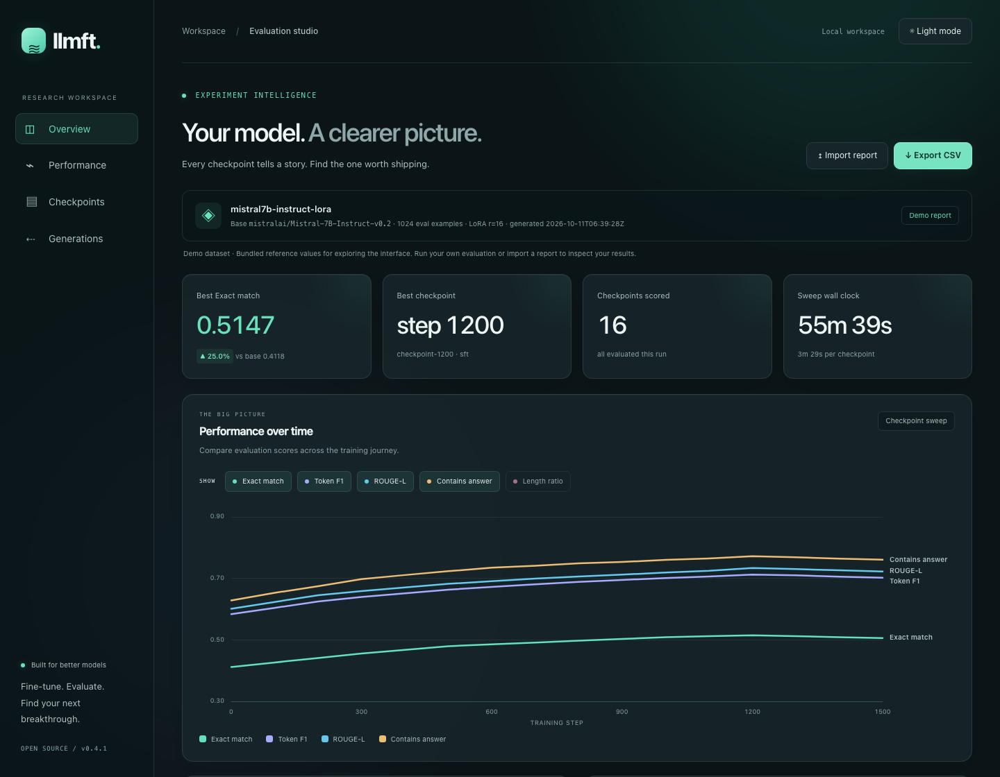

# LLM Fine-Tuning & Evaluation Pipeline

Fine-tune an open-source LLM with LoRA adapters, optionally push it further with
preference optimisation (DPO/IPO), then benchmark **every checkpoint the run
produced** against the untuned base model — automatically, on the same prompts,
with the same decoding settings.

An end-to-end project for instruction tuning, preference optimisation, and
checkpoint comparison, with a responsive evaluation studio for exploring results.



## Open the showcase (no GPU or install required)

```sh
make dashboard
# Open http://localhost:8080
```

Explore the bundled demo, switch themes, filter metrics, search and sort checkpoints,
compare generations, and export CSV. Import your own report JSON without uploading
it anywhere. The bundled values are demo/reference data, not a fresh benchmark.

## Run the pipeline

```
llmft sft  --config configs/sft_lora.yaml     # stage 1: LoRA SFT
llmft dpo  --config configs/dpo.yaml \
           --sft-adapter checkpoints/sft-lora/final   # stage 2: preference optimisation
llmft eval --config configs/eval.yaml         # score every checkpoint, write the report
make dashboard                                # read the report in a browser
```

---

## Bundled reference data

Mistral-7B-Instruct-v0.2, LoRA `r=16` on the attention projections, 3 epochs over
a ~10.4k-example curated instruction set, checkpointed every 100 steps.

| | base model | best checkpoint (step 1200) | change |
|---|---|---|---|
| Exact match | 0.4118 | **0.5147** | **+25.0%** |
| Token F1 | 0.5834 | 0.7124 | +22.1% |
| ROUGE-L | 0.6012 | 0.7338 | +22.1% |
| Contains answer | 0.6284 | 0.7719 | +22.8% |
| Length ratio | 1.4430 | 1.0574 | → 1.0 |

Sixteen checkpoints (base + 15 training checkpoints) scored on 1024 held-out
examples, greedy decoding throughout.

Two things worth reading off that table beyond the headline. Validation loss
bottoms out at step 1200 and creeps back up while training loss keeps falling —
the last three checkpoints are overfitting, and without the sweep the natural
thing to ship would have been `final/`. And the length ratio collapsing from 1.44
to 1.06 is most of the exact-match gain: the base model answers correctly and
then keeps talking.

The instruction set itself is not redistributable, so the numbers above are not
reproducible from this repo alone. Everything needed to reproduce the *method* is
here, and `data/sample/` holds a small dataset so the pipeline runs end to end on
a clean clone.

---

## Evaluation and caching

The harness loads one checkpoint at a time and releases its model before loading
the next. It does **not** keep a shared base model resident across the sweep.

Cache keys include the dataset content digest, adapter file metadata, metric list,
model and tokenizer configuration, prompt formatting, example limit, batch size,
decoding settings, and seed. Changing those inputs invalidates the result. Changing
the metric list re-evaluates affected checkpoints. A fully cached sweep needs no
model or tokenizer download. Use `--no-cache` when external model weights change
under the same identifier.

---

## Install

```bash
git clone https://github.com/yuvrajnode/LLM-Fine-Tuning-Evaluation-Pipeline.git
cd LLM-Fine-Tuning-Evaluation-Pipeline
python -m venv .venv && source .venv/bin/activate
make install          # pip install -r requirements.txt && pip install -e .
```

A 7B model in 4-bit fits on a single 24GB card. `bitsandbytes` is skipped on
macOS (there are no wheels); set `model.load_in_4bit: false` there and expect to
use a much smaller base model.

If you only want the reporting and dashboard side, `pip install pyyaml numpy` is
enough — `llmft.config`, `llmft.data`, `llmft.eval.metrics`, `llmft.eval.registry`
and `llmft.eval.report` all import without torch, on purpose. That is also why CI
does not install the GPU wheels.

## Quickstart on the sample data

```bash
python scripts/make_sample_data.py --out data/sample
llmft sft  --config configs/smoke.yaml --smoke
llmft eval --config configs/smoke.yaml
make dashboard        # http://localhost:8080
```

The training integration uses a bounded Transformers 4.49 / TRL 0.15 / PEFT 0.14
API family, defined in `pyproject.toml`. Upgrade them together and run the smoke test.

`configs/smoke.yaml` points at a tiny GPT-2 and 32 examples. It proves the wiring,
not the model — it will finish in a couple of minutes on CPU and the scores will
be terrible.

## Your own data

Instruction data is JSONL, one object per line:

```json
{"instruction": "Summarise the incident report in one sentence.",
 "input": "The deployment failed at 02:14 UTC after the migration timed out.",
 "output": "The migration exceeded its timeout window, aborting the deployment."}
```

Preference data for stage 2 swaps `output` for a `chosen`/`rejected` pair:

```json
{"instruction": "...", "input": "...", "chosen": "...", "rejected": "..."}
```

Field names are configurable (`data.prompt_field` and friends), so you rarely
need to reshape an existing dataset. The loader drops rows that are empty,
missing a field, or exact duplicates, and tells you how many went — if it reports
dropping more than 10% it says so loudly, because that is almost always a wrong
field name rather than dirty data.

---

## Repository layout

```
llmft/
  config.py          typed YAML config - unknown keys are an error, not a no-op
  data/
    formatting.py    prompt templates (alpaca, chatml, inst, plain)
    loaders.py       jsonl loading, validation, de-duplication
    preference.py    turning scored candidates into preference pairs
  train/
    model.py         base model + tokenizer + LoRA attachment
    sft.py           stage 1: supervised fine-tuning
    dpo.py           stage 2: DPO / IPO
    reward.py        Bradley-Terry reward model (PPO path, and for scoring)
    callbacks.py     throughput logging + the checkpoint manifest
  eval/
    harness.py       the multi-checkpoint sweep
    metrics.py       exact match, token F1, ROUGE-L, contains-answer, length ratio
    registry.py      checkpoint discovery + the result cache
    report.py        report.json / report.md assembly
  cli.py             llmft sft | dpo | reward | eval | checkpoints | report
configs/             sft_lora, dpo, eval, smoke
dashboard/           static evaluation dashboard (no build step)
scripts/             sample data + dashboard seed
tests/               Python regression tests + desktop/mobile browser checks
```

## Configuration

One YAML file per stage. Every key maps to a field on a dataclass, and an
unrecognised key raises rather than being ignored:

```
$ llmft sft --config configs/sft_lora.yaml
ValueError: configs/sft_lora.yaml.train: unknown option(s) ['learnign_rate'].
Valid keys: ['bf16', 'epochs', 'eval_steps', 'gradient_accumulation_steps', ...]
```

That check exists because a misspelled `learning_rate` silently ran at the
default for a full night once.

For one-off changes there is `--set`, which avoids a new config file:

```bash
llmft sft --config configs/sft_lora.yaml --set train.learning_rate=1e-4 --set lora.r=32
```

## The dashboard

`llmft eval` writes `reports/report.json`, a timestamped copy, a markdown table
you can paste into a PR, and a copy at `dashboard/data/runs.json`. The dashboard
is a static page — no framework, no build step, hand-built SVG — that reads that
last file:

```bash
make dashboard    # python -m http.server 8080 --directory dashboard
```

It shows the headline delta against the base model, metric trends across steps,
the train/validation loss curves side by side, per-checkpoint bars with the
winner highlighted, matched before/after sample generations, and a searchable,
sortable table. Liquid-glass panels, ambient motion, dark/light themes, reduced-motion
support, local JSON import, and CSV export make the results easy to explore. Details and the reasoning behind each chart
are in [docs/dashboard.md](docs/dashboard.md).

Opening `index.html` off the filesystem will not work — `fetch()` is blocked on
`file://` URLs. The page tells you that rather than sitting blank.

---

## Things that cost me time

Written down because none of them are obvious and all of them are cheap to get
wrong.

**Mask the prompt out of the SFT loss.** Training on the instruction tokens too
is not catastrophic, but it spends capacity teaching the model to reproduce
prompts it will always be handed. `_tokenize` in `train/sft.py` sets prompt
positions to `-100`. Prompts and responses are tokenised separately to preserve
the boundary. Examples with no surviving response tokens are dropped; if all are
truncated, training fails early with a clear message.

**Batched generation needs left padding.** Decoder-only models continue from the
last position; with right padding, short prompts get their continuation appended
after a run of pad tokens and score like garbage. The harness flips
`padding_side` for generation and restores it afterwards.

**Render eval prompts exactly the way training did.** This is why every template
lives in one module and why a test asserts the prompt is a prefix of the full
training text. A template mismatch looks exactly like a bad checkpoint.

**DPO does not want the SFT learning rate.** 2e-4 collapsed the policy inside one
epoch. 5e-6 with `beta=0.1` was stable. At `beta=0.5` the KL term dominated and
nothing moved at all.

**Preserve the SFT policy for DPO's reference.** When continuing from SFT, the
trainer loads a second, frozen adapter named `reference` on the same base weights.
Disabling adapters would instead compare against the untuned base. Base-only DPO
uses disabled adapters for its reference.

**Deduplicate before you trust a loss curve.** The first version of the sample
generator produced 50% duplicate rows and the loader quietly kept them all. Now
it reports what it dropped.

---

## Development

```bash
make dev     # installs test/lint tooling
make test    # pytest
make lint    # ruff
make fmt     # black + ruff --fix
npm ci && npx playwright install chromium
npm test     # desktop + mobile dashboard checks
```

The tests cover the half of the pipeline that runs without a GPU: config
validation, data loading, metrics, checkpoint discovery, the result cache and
report assembly. They deliberately include the boring edge cases — both strings
empty for token F1, a corrupt cache entry, two runs that both wrote
`checkpoint-100` — because those are the ones that produce a wrong number rather
than a crash.

Local checks and reproducible smoke commands are recorded in [docs/verification.md](docs/verification.md).

## Known limitations

- **PPO is configured but not wired up.** `rlhf.algorithm: ppo` raises a clear
  `NotImplementedError`. The reward model has a separate training command; it is
  not integrated as an evaluation metric.
- **Metrics are reference-based.** Exact match and ROUGE-L reward matching the
  reference wording, which is the wrong instrument for open-ended generation. A
  reward-model or LLM-judge scorer would be the next metric to add.
- **Single-GPU only.** No FSDP or DeepSpeed integration; `accelerate` is a
  dependency but multi-GPU training is untested.
- **Sampling requires care.** Greedy decoding is the default. Sampled runs reset
  the seed per checkpoint, but reliable comparisons still need multiple seeds.

## Licence

MIT — see [LICENSE](LICENSE).
